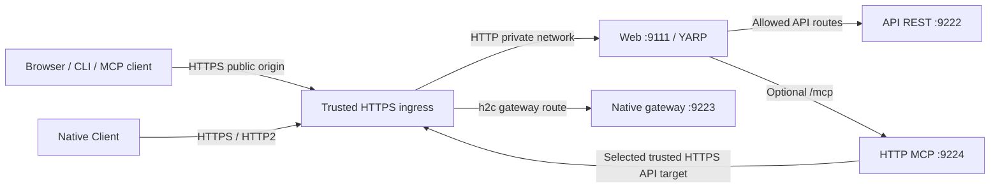

# One public HTTPS origin with Web and YARP

The public HTTPS origin terminates at a trusted outer ingress, which sends Web traffic to `web:9111`. Web uses YARP to forward the supported REST paths to `api:9222` and, when selected, `/mcp` to `mcp-http:9224` on the shared Compose network. The operator supplies the public origin and selects MCP; Docker DNS supplies the backend addresses.



REST `9222`, native HTTP/2 gateway `9223`, HTTP MCP `9224`, and Web `9111` are separate listeners. The native gateway has its own HTTP/2 ingress profile; do not point REST or MCP routes at it. See [native gateway operation](../client/CLIENT.md#sustained-traefik-gateway-streams).

## Generated routes and explicit overrides

`ApiBaseUrl` is the Web API-client backend and the generated `apiCluster/api1` destination. Compose supplies `http://api:9222/`; a local-process or split-host deployment supplies its own explicit URL. Set `WebGateway__Topology` to `Compose`, `LocalProcess`, or `SplitHost` to describe the deployment. Topology never scans ports or selects another server on failure. `localhost` inside a container means that container, not API or MCP.

The optional Compose MCP overlay configures **both** the MCP service and Web. Selecting a Docker profile by itself does not change another service's environment. Web's gateway keys are:

| Environment key | Meaning |
| --- | --- |
| `ApiBaseUrl` | Default private REST backend; also used by Web API clients |
| `NETRATEL_PUBLIC_ORIGIN` / `PublicBaseUrl` | Trusted configured HTTPS public origin; canonical variable wins over compatibility option |
| `WebGateway__Topology` | Explicit topology label |
| `WebGateway__Mcp__Enabled` | Generate MCP routes; default `false` |
| `WebGateway__Mcp__BackendUrl` | Explicit MCP destination; Compose supplies `http://mcp-http:9224/` |
| `WebGateway__Mcp__AuthenticationMode` | `LocalCredential` or `Oidc`; OIDC additionally needs the exact protected-resource metadata route |
| `WebGateway__Mcp__ActivityTimeout` | MCP proxy activity budget; default `00:05:00` |

The [URL-first HTTP MCP host wizard](../mcp-http/setup.md) asks for the instance Web URL, discovers the supported authentication mode and generates the coordinated Web/API/MCP overlay. A root URL and the same origin's `/mcp` URL normalize to that common deployment. Storage and private Compose backend addresses are defaults; use Advanced only for an intentionally different topology. Saving does not update other containers: run its exact generated apply action on the deployment host, retaining existing ingress/database overlays, then resume the actual transport verification. The final Connected state requires authenticated MCP plus a read-only API-backed call through the dedicated host identity/delegation.

One effective YARP configuration combines generated defaults with `ReverseProxy`. Same-ID scalar fields explicitly override generated fields while omitted fields remain. Collection fields (transforms, methods, hosts, headers, query parameters and destinations) replace completely per configuration provider. The composer creates one effective result rather than relying on multiple YARP providers to merge partial objects. Custom route/cluster IDs remain available. Advanced operators may deliberately choose a proxy destination different from `ApiBaseUrl`; that affects proxy calls, while Web API clients retain `ApiBaseUrl`.

Disabling MCP removes generated MCP exposure and performs no backend discovery. It preserves a manually configured explicit MCP route. A selected but unavailable backend returns a proxy failure, not the Blazor HTML page or another instance. `ReverseProxy:RemovedRoutes` and `ReverseProxy:RemovedClusters` are string arrays applied last. Removing a cluster still referenced by an active route is invalid. Scalar values compose by case-insensitive route/cluster ID; explicit destination and list values replace their generated/provider values. Check the effective configuration before applying a custom allowlist.

Environment and generated gateway settings are startup inputs. Recreate a container after changing its environment; `docker compose restart` retains the old environment. Reloadable `ReverseProxy` file configuration can reload only a valid candidate. It cannot alter startup API-client options or another container's configuration. Keep the last valid routing configuration on an invalid reload and correct the source before trying again.

## Supported API paths

Keep the API allowlist. Do not add a blanket `/api/{**catch-all}` or `/api/v2/{**catch-all}` route.

| Public path | Backend and transform |
| --- | --- |
| `/api/docs` and `/api/docs/` | Scalar UI hosted by Web; document JSON loads through the next route |
| `/api/openapi/{**catch-all}` | API; remove `/api`, set `X-Forwarded-Prefix: /api` |
| `/api/v1/{**catch-all}` | API; preserve path, set forwarded prefix |
| `/clients/install/{**catch-all}` | API; preserve path and capability URL; disable intermediary caching and capability logging |
| `/api/v2/agents/{**catch-all}` | API; preserve path, set forwarded prefix |
| `/api/v2/agent-updates/{**catch-all}` | API; preserve path, set forwarded prefix |
| `/api/v2/setup/{**catch-all}` | API bootstrap; preserve path, set forwarded prefix |
| `/api/v2/branding/{**catch-all}` | API branding; preserve path, set forwarded prefix |
| `/api/v2/local-auth/{**catch-all}` | API local browser authentication; preserve path, set forwarded prefix |
| `/.well-known/oauth-authorization-server` | API service authorization-server metadata; preserve path |
| `/.well-known/service-jwks.json` | API service public keys; preserve path |
| `/connect/token` | API service-token endpoint; preserve path |
| `/api/pairing/v1/metadata` (`GET`) | API RatelDesk pairing metadata; forward only the allowed `X-Pairing-Nonce` request header |
| `/health/live`, `/health/ready` | Exact GET-only API health routes; retain protected API `HealthRead` authorization. These probe the API, while the private MCP listener has separate host health endpoints. |
| `/internal/health`, `/internal/catalog/jobs`, `/internal/catalog/tenants`, `/internal/catalog/request-definitions`, `/internal/ingest` | API orchestration paths; retain their API authentication requirements |

The generated configuration additionally exposes these narrowly scoped onboarding and operator paths; their API auth and policy checks remain authoritative:

| Public path | Scope |
| --- | --- |
| `/api/integration-pairing/v1/capabilities` (`GET`) | Pairing capability discovery |
| `/api/integration-pairing/v1/start`, `/poll`, `/cancel`, `/acknowledge` (each `POST` under that prefix) | Bounded credential-pairing protocol |
| `/api/http-host-setup/v1/capabilities` (`GET`), `/start`, `/poll`, `/cancel` (`POST`) | Origin-bound administrator approval of a specific deployment-host generation; distinct from personal credential pairing |
| `/api/v2/account/integration-credentials/{**catch-all}` | Existing interactive account credential management |
| `/api/v2/mcp/local-delegation/authenticate`, `/exchange` (`POST`) | Local MCP ingress check and per-call delegation |
| `/api/v2/mcp/operator/{**catch-all}` | Authorized production operator API |
| `/api/v2/development/mcp/{**catch-all}` | Explicit development MCP surface |
| `/api/v2/tasks/{**catch-all}` | Authorized task operations |
| `/api/v2/client-presence/{**catch-all}` (`GET`) | Client presence reads |
| `/api/v2/tenants/{tenantId:int}/primary-client-bindings/agents/{agentId:guid}` | Exact primary-client binding pattern |

`GET /api/v1/auth/ai-agent/status` provides the existing API-purpose client read-only identity/authority check through the V1 route. It rejects an HttpMcp bearer and does not expose tenant inventories or administrator data. These routes do not expose unrelated V2 paths. The [HTTP MCP configuration guide](../mcp-http/configuration.md) identifies the selected outbound HTTPS target and its required operations.

Explicit `Authorization: Bearer ...` headers pass through unchanged. Web's existing `/api/v1` browser-session projection applies only when the request has no explicit Authorization header. Proxy routing does not authenticate an MCP bearer; the MCP host owns ingress authentication and the API owns delegation and business authorization. Generated API transforms disable YARP's implicit forwarded-prefix transform while retaining trusted For/Host/Proto forwarding, so the explicit `/api` prefix reaches API. If replacing the entire `Transforms` list, retain the supported `{ "X-Forwarded": "Set", "Prefix": "Off" }` forwarding policy alongside the explicit prefix transform.

## Manual configuration for existing or custom deployments

For deployments maintaining their own YARP configuration, merge these additional entries into the existing `ReverseProxy` section. Retain existing API routes and cluster settings. The exact `/mcp` path (including its ordinary trailing slash) reaches MCP unchanged; unrelated child paths are not exposed. Do not add a `PathRemovePrefix` transform.

```json
{
  "ReverseProxy": {
    "Routes": {
      "mcpRoute": {
        "ClusterId": "mcpCluster",
        "Match": { "Path": "/mcp" }
      }
    },
    "Clusters": {
      "mcpCluster": {
        "HttpRequest": { "ActivityTimeout": "00:05:00", "AllowResponseBuffering": false },
        "Destinations": { "mcp1": { "Address": "http://mcp-http:9224/" } }
      }
    }
  }
}
```

For external OIDC only, add the exact same-origin metadata endpoint:

```json
{
  "ReverseProxy": {
    "Routes": {
      "mcpMetadataRoute": {
        "ClusterId": "mcpCluster",
        "Match": { "Path": "/.well-known/oauth-protected-resource/mcp" }
      }
    }
  }
}
```

`/.well-known/oauth-protected-resource/mcp` is mapped by the HTTP MCP host for OIDC. It differs from API `/.well-known/oauth-authorization-server`. Local credential mode neither advertises OAuth metadata nor invents an authorization server; omit the generated/manual MCP metadata route in that mode.

Equivalent shell-safe environment entries are:

```dotenv
ReverseProxy__Routes__mcpRoute__ClusterId=mcpCluster
ReverseProxy__Routes__mcpRoute__Match__Path=/mcp
ReverseProxy__Clusters__mcpCluster__Destinations__mcp1__Address=http://mcp-http:9224/
ReverseProxy__Clusters__mcpCluster__HttpRequest__ActivityTimeout=00:05:00
ReverseProxy__Clusters__mcpCluster__HttpRequest__AllowResponseBuffering=false
```

For an OIDC host, additionally inject:

```dotenv
ReverseProxy__Routes__mcpMetadataRoute__ClusterId=mcpCluster
ReverseProxy__Routes__mcpMetadataRoute__Match__Path=/.well-known/oauth-protected-resource/mcp
```

Use shell-safe route identifiers such as `mcpRoute`. Shell entrypoints can discard variable names containing hyphens even when Docker's configured environment contains them. Existing file route IDs remain compatible; use JSON for those advanced overrides. A standalone/split deployment replaces the backend address with the explicitly chosen reachable HTTP(S) MCP endpoint. Separate Compose networks need a deliberate shared network or routable destination; a service name on another isolated network is not discoverable.

## Streaming, authentication and trust

Keep YARP `AllowResponseBuffering=false` for MCP. Choose an activity/idle budget that accommodates expected streams; it measures inactivity, not an unlimited whole-request lifetime. Preserve cancellation and incremental delivery. At the outer ingress, disable response buffering/caching for `/mcp`, forward Authorization and protocol headers, and set compatible read/send/idle budgets. Validate an incremental response through the actual ingress; a completed buffered response proves only that the request eventually finished.

Forwarded headers affect public URL construction only from explicitly trusted proxy addresses/networks. Configure `ForwardedHeaders__KnownProxies`, `KnownIPNetworks` and `AllowedHosts` for the real ingress, using the [configuration trust guidance](CONFIGURATION.md#reverse-proxy-trust). Public resources and Web API-reference URLs come from deployment-owned configuration, never an arbitrary incoming Host header. Without a configured public origin, Web uses relative Web-root reference/OpenAPI URLs.

Web's private HTTP API/MCP destinations do **not** override MCP's outbound HTTPS and selected-target validation. Set the MCP outbound API URL and the selected `dev` or `prod` API allowlist entry to the same public Web HTTPS origin, or the same privately trusted HTTPS API endpoint. `http://api:9222/` is appropriate for Web's private hop, not for the MCP outbound target. A privately trusted HTTPS endpoint requires its certificate chain to be trusted inside MCP. `ServiceLinks__AllowPrivateHttp` does not change this boundary.

Local ingress requires the exact canonical HTTPS `/mcp` resource on the API and MCP host plus matching deployment-owned delegation issuer, audience, service principal, key ID and signing material. A human HttpMcp bearer is not the host's outbound gateway identity. External OIDC is an explicit separate option. See [authentication](../mcp-http/authentication.md) and the [complete configuration mapping](../mcp-http/configuration.md).

## Verify the origin

1. Validate configuration and render Compose with `config --quiet`; do not print secret-bearing rendered configuration. Confirm containers share their intended network and the MCP selected HTTPS target is trusted.
2. Fetch public `/api/docs/` and `/api/openapi/v1.json`. The first returns the Web-hosted reference UI; the second returns API JSON. Unknown API paths must retain the existing API guard behavior.
3. Send an unauthenticated MCP request using an MCP-compatible Accept header. Check the status, content type and auth challenge. A 401/403 helps locate routing/authentication; HTML from the Blazor fallback indicates the route did not reach MCP. A 502 indicates the selected backend is unavailable.
4. In OIDC mode, fetch `/.well-known/oauth-protected-resource/mcp` and check the exact resource/authorization server. In local credential mode, no OAuth protected-resource metadata is advertised.
5. Use an approved client credential to complete MCP `initialize`, then execute one permitted read-only tool for an approved tenant/target. Confirm actual grants and delegation, not just a successful HTTP response. Do not use a mutating operation as a diagnostic.
6. If streams matter, observe an incremental response through the public ingress; test backend recovery and persistent configuration during owner acceptance.

The source routing/configuration tests cover deterministic route composition and header boundaries. Full ingress/container/browser acceptance remains opt-in or owner testing under [AGENTS.md](../../AGENTS.md); a route check alone is not successful onboarding.
